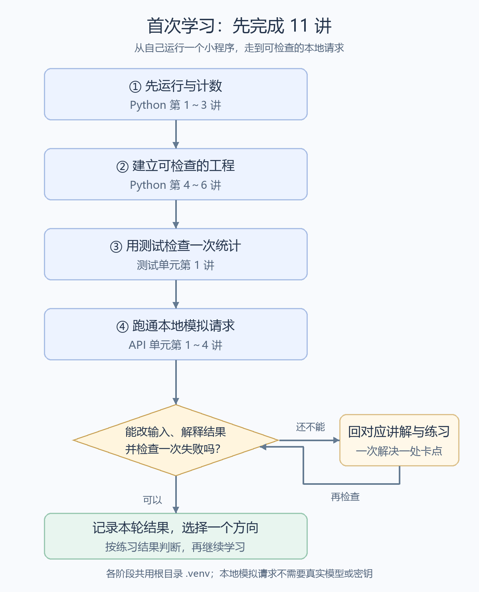
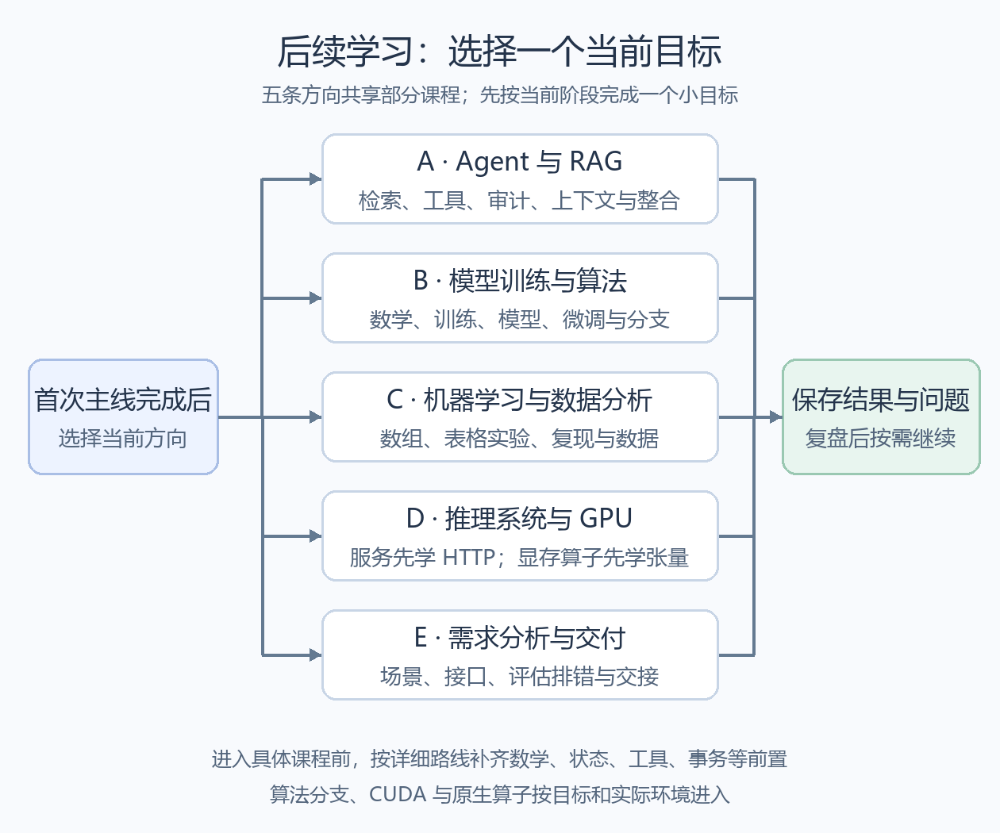
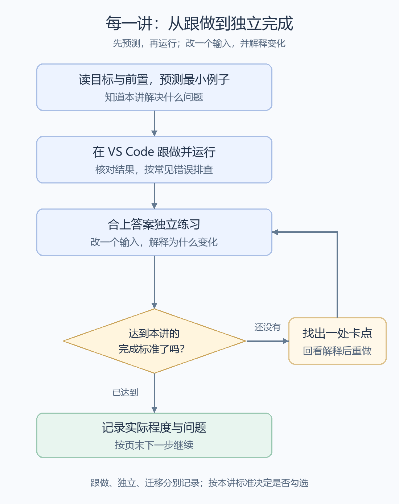

# 学习流程图

> [!nav] 页面导航
> [[00 从这里开始|学习首页]] · [[00_学习路线/00 选择你的学习方向|选择方向]] · [[02_学习记录/02 学习总表|排期与进度]]
>
> 本页：[[#先完成首次11讲|首次主线]] · [[#再选择一个后续方向|五个方向]] · [[#每一讲怎样学完|每讲的学习循环]]

## 现在从哪里开始

第一次学习，从 [[01_学习指南/01_Python工程化/逐讲学习/01 运行Python并统计工单|运行 Python 并统计工单]] 开始。已经开始时，先看 [[02_学习记录/00 我的学习记录#下次从哪里继续|上次留下的继续位置]]。

图中的箭头表示建议学习顺序；后续方向与进阶分支按当前目标选择。图概括路线，具体概念、操作和前置要求仍在链接中的详细教程里。图中没有标记你的实际完成状态。

## 先完成首次11讲

这 11 讲来自三个单元，按首次主线跨单元继续；不用先读完这三个单元的所有课程。每个方框对应下方同编号的课程入口。



> [!info]- 可缩放原图与可编辑图源
> [打开 SVG 原图](./assets/learning-first-path.svg)
>
> ```mermaid
> flowchart TD
>     F1["① 先运行与计数<br/>Python 第 1～3 讲"]
>     F2["② 建立可检查的工程<br/>Python 第 4～6 讲"]
>     F3["③ 用测试检查一次统计<br/>测试单元第 1 讲"]
>     F4["④ 跑通本地模拟请求<br/>API 单元第 1～4 讲"]
>     CHECK{"能改输入、解释结果<br/>并检查一次失败吗？"}
>     PRACTICE["挑出一处卡点<br/>回对应讲解与练习"]
>     NEXT["记录本轮结果<br/>选择一个后续方向"]
>     F1 --> F2 --> F3 --> F4 --> CHECK
>     CHECK -->|还不能| PRACTICE
>     PRACTICE --> CHECK
>     CHECK -->|可以| NEXT
> ```

| 图中阶段 | 打开哪里 | 本阶段做出什么 |
|---|---|---|
| ① 运行与计数 | [[00_学习路线/01 从零开始建立共同基础#阶段 1：先运行与计数\|阶段 1 的三讲]] | 运行工单统计，改输入，说明函数与模块的职责 |
| ② 检查输入与失败 | [[00_学习路线/01 从零开始建立共同基础#阶段 2：建立可检查的工程\|阶段 2 的三讲]] | 解释复制与逐条读取，处理非法输入并清理文件资源 |
| ③ 第一个测试 | [[01_学习指南/02_测试与实验复现/逐讲学习/01 写第一个 pytest 测试\|测试入门]] | 看见测试通过，故意改错使它失败，再解释并修正 |
| ④ 本地模拟请求 | [[00_学习路线/01 从零开始建立共同基础#阶段 4：跑通本地模拟请求\|阶段 4 的四讲]] | 检查结构化输出、有限重试和缓存；构造一次参数失败 |

阶段 ④ 使用本机模拟服务，首次学习不需要真实模型、密钥或付费请求。各阶段共用工作区根目录的 `.venv`，运行目录按 [[00_学习路线/01 从零开始建立共同基础|首次学习主线]] 切换。

## 再选择一个后续方向

先选一个当前最想解决的问题。五条方向可以共享课程；它们是不同的学习目标，不需要同时完成。



> [!info]- 可缩放原图与可编辑图源
> [打开 SVG 原图](./assets/learning-directions.svg)
>
> ```mermaid
> flowchart LR
>     CHOOSE{"首次主线完成后<br/>当前想做什么？"}
>     AGENT["A · Agent 与 RAG<br/>检索 → 工具 → 可靠执行<br/>→ 审计、上下文与 Harness"]
>     TRAIN["B · 模型训练与算法<br/>数学与训练 → 模型与样本<br/>→ 微调 → 选择算法分支"]
>     DATA["C · 机器学习与数据分析<br/>数组与概率 → 表格实验<br/>→ 复现与数据能力"]
>     GPU["D · 推理系统与 GPU<br/>服务入门先学 HTTP<br/>显存与算子先学张量"]
>     DELIVERY["E · 需求分析与交付<br/>场景与边界 → 接口与数据<br/>→ 评估排错 → 演示交接"]
>     RESULT["按当前阶段的标准<br/>完成一个小目标<br/>保存结果与问题"]
>     CHOOSE --> AGENT
>     CHOOSE --> TRAIN
>     CHOOSE --> DATA
>     CHOOSE --> GPU
>     CHOOSE --> DELIVERY
>     AGENT --> RESULT
>     TRAIN --> RESULT
>     DATA --> RESULT
>     GPU --> RESULT
>     DELIVERY --> RESULT
> ```

| 图中方向 | 详细路线 | 按需要继续的内容 |
|---|---|---|
| A · Agent 与 RAG | [[00_学习路线/02 学习Agent与RAG应用\|应用方向的分阶段路线]] | 第一轮到工具循环；上下文预算在 Harness 前补，长期记忆、工作流、MCP 和推理策略按需继续 |
| B · 模型训练与算法 | [[00_学习路线/03 学习模型训练与大模型算法\|训练与算法的分阶段路线]] | 微调后选择偏好优化、工具使用训练或 PPO／GRPO 等机制分支，再按实验需要学分布式与论文 |
| C · 机器学习与数据分析 | [[00_学习路线/04 学习传统机器学习与数据分析\|数据方向的分阶段路线]] | 根据项目补测试、SQL 和数据结构算法，再整理项目证据 |
| D · 推理系统与 GPU | [[00_学习路线/05 学习推理系统与GPU工程\|系统方向的分阶段路线]] | 服务入门可先做 HTTP 与合成流式实验；完整模型实验、显存／并行和算子先补系统与张量基础 |
| E · 需求分析与交付 | [[00_学习路线/06 学习需求分析与项目交付\|交付方向的分阶段路线]] | 根据项目补检索、状态机、工具契约和可靠执行，再完成方案与交接 |

这些方框只概括各方向，不能据此跳过前置。例如系统方向进入训练前仍要补数学；独立 HTTP 入门可先学，进入完整后端任务系统再补状态、工具与事务。请打开对应路线，按阶段中的补课链接继续。

CPU 路径帮助先理解机制；PyTorch 的 CUDA 操作、显存实验与原生 CUDA 分别在相应单元进入，按实际环境与教程边界操作。

## 每一讲怎样学完



> [!info]- 可缩放原图与可编辑图源
> [打开 SVG 原图](./assets/learning-cycle.svg)
>
> ```mermaid
> flowchart TD
>     READ["读本讲目标与前置<br/>先预测一个最小例子的结果"]
>     RUN["在 VS Code 跟做并运行<br/>核对实际结果，处理报错"]
>     TRY["合上答案独立练习<br/>改一个输入并解释变化"]
>     TEST{"达到本讲的<br/>完成标准了吗？"}
>     REVIEW["定位一个不懂的步骤<br/>回看解释，再做一次"]
>     RECORD["记录实际程度与问题<br/>按页末下一步继续"]
>     READ --> RUN --> TRY --> TEST
>     TEST -->|还没有| REVIEW
>     REVIEW --> TRY
>     TEST -->|已达到| RECORD
> ```

跟着答案运行成功时，记录为“跟做完成”；能独立解释和修改后，再按本讲标准判断是否勾选。迁移练习用于检查能否换一份数据或换一个问题使用同样的方法。遇到报错时，先按本讲的常见错误排查。

> [!next] 下一步
> 首次学习，打开 [[01_学习指南/01_Python工程化/逐讲学习/01 运行Python并统计工单|第 1 讲：运行 Python 并统计工单]]。已经开始时，回到 [[02_学习记录/00 我的学习记录#下次从哪里继续|下次继续的位置]]。

> [!info]- 图没有显示时
> 在 Obsidian 中切到阅读视图查看。图下的表格保留同样的课程入口，可以直接进入；本页默认显示本地 PNG 图片，折叠区提供可缩放的 SVG 原图与 Mermaid 图源。若 Obsidian 对 Mermaid 提示信任，仍可直接阅读上方图片。
