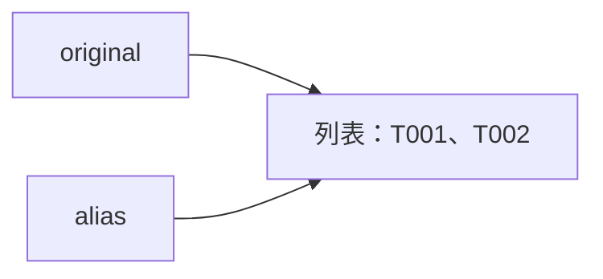

# 第 4 讲：分清对象引用与浅深复制

> [!nav] 页面导航
> 首次主线 4/11 · [[01_学习指南/01_Python工程化/00 Python 工程化学习地图#学习顺序|单元 01：Python 工程化]] · [[01_学习指南/01_Python工程化/逐讲学习/03 用类型标注与数据类表达记录|上一讲]] · [[01_学习指南/01_Python工程化/逐讲学习/05 用生成器逐条处理数据|下一讲]]

## 先做什么，学完怎样判断

先完成第 1 讲的变量、列表、字典和函数。这里不要求会生成器或装饰器。先读第 1～4 节，再在 VS Code 运行第 5 节的完整示例；最后独立修改一张工单，确认原工单没有一起变化。第 7 节是可稍后复习的进阶边界。

本课要解决一个常见困惑：“我明明改的是备份，为什么原始数据也变了？”后面的实验配置、任务状态和记录快照都会遇到它。复制策略不对，会让对照实验的两组输入相互影响。

> [!contents]- 本讲导航
> - [[#先做什么，学完怎样判断|先做什么，学完怎样判断]]
> - [[#1. 赋值给对象增加名字|1. 赋值给对象增加名字]]
> - [[#2. 切片复制外层列表|2. 切片复制外层列表]]
> - [[#3. 浅复制仍共享内层对象|3. 浅复制仍共享内层对象]]
> - [[#4. 深复制用于本课的嵌套普通数据|4. 深复制用于本课的嵌套普通数据]]
> - [[#5. 运行完整工单示例并读函数|5. 运行完整工单示例并读函数]]
> - [[#6. 由易到难练习|6. 由易到难练习]]
> - [[#7. 可稍后学：共享结构与 frozen 的边界|7. 可稍后学：共享结构与 frozen 的边界]]
> - [[#8. 常见错误与完成检查|8. 常见错误与完成检查]]
> - [[#官方核对与后续|官方核对与后续]]

## 1. 赋值给对象增加名字

在 VS Code 打开本单元 `示例工程`，新建 `lesson_alias.py`，保存并运行下面完整内容：

```python
original = ["T001"]
alias = original
alias.append("T002")
print(original)
print(alias is original)

alias = ["T003"]
print(original)
print(alias)
```

终端位于 `01_学习指南/01_Python工程化/示例工程`，运行：

```powershell
..\..\..\.venv\Scripts\python.exe lesson_alias.py
```

`..` 向上一级，三个 `..` 回到仓库根；后面选择共享环境中的解释器，最后是刚创建的脚本。不要重新创建环境。

预期依次输出：

```text
['T001', 'T002']
True
['T001', 'T002']
['T003']
```

逐步解释：

1. 第一行创建列表对象，再把名字 `original` 绑定到它。**对象**是实际保存数据的东西，**引用**让名字能够找到对象。
2. `alias = original` 让另一个名字找到同一列表，没有自动复制列表。
3. `append` 在已有列表末尾添加元素，因此两个名字看到的内容都变化了。这叫“原地修改”。
4. `is` 问的是“两边是不是同一个对象”，所以为 `True`。`==` 问的是内容是否相等，两份不同列表也可以内容相等。
5. `alias = ["T003"]` 创建另一列表，并让 `alias` 改为指向它，叫“重新绑定”。原列表没有被清空，`original` 仍找到它。

可以把变量名想成贴在物品上的标签；但 Python 并不真的往对象上贴字，它维护名字与对象的绑定关系。用箭头画出这层关系比记忆“变量是盒子”更准确：



图表示执行 `append` 后、重新绑定前的状态。重新绑定时，只把 `alias` 的箭头移向新列表。

## 2. 切片复制外层列表

索引从 `0` 开始。`values[start:stop]` 取从 `start` 开始、到 `stop` **之前**的元素，称为左闭右开；省略开头或结尾表示取到相应边界。

把以下内容单独保存为 `lesson_slice.py` 并用同一个解释器运行：

```python
values = [10, 20, 30, 40]
print(values[1:3])
print(values[-2:])
print(values[9:])

copied = values[:]
print(copied == values, copied is values)
copied[0] = 99
print(values, copied)
```

预期：

```text
[20, 30]
[30, 40]
[]
True False
[10, 20, 30, 40] [99, 20, 30, 40]
```

`-1` 表示最后一个位置，`-2` 表示倒数第二个；`values[9:]` 是空切片，不会像访问不存在的单个位置 `values[9]` 那样报 `IndexError`。`values[:]` 取得整个列表的浅复制；对普通内置列表，也可以写成更明确的 `values.copy()`。

`copied[0] = 99` 换掉新列表第 0 个位置所引用的元素，没有修改原列表的位置。整数本身不可原地修改，因此这个一层数字列表看起来已经完全独立。遇到列表里面还有字典或列表，就要继续看下一节。

## 3. 浅复制仍共享内层对象

进入嵌套列表前，再比较一个字符串。字符串也支持索引与切片，但不能原地改其中一个字符。在同一目录新建 `lesson_string.py`：

```python
word = "agent"
part = word[1:4]
changed = "A" + word[1:]
print(part)
print(changed)
print(word)
```

运行共享解释器加文件名，输出为 `gen`、`Agent`、`agent` 三行。`word[1:4]` 仍是取索引 1、2、3；`+` 把字符串拼接成结果，赋给 changed，原 word 不变。若另加 `word[0] = "A"`，会报 TypeError；要修改文本，先构造新字符串再重新绑定名字。列表切片会创建新外层列表，字符串切片不应被用于承诺新的对象身份；这里只检查文本内容。

**浅复制**创建新的外层容器，里面仍引用原有的元素。下面是一张工单的三层结构：外层工单列表 → 工单字典 → 标签列表。

```python
original = [{"id": "T001", "tags": ["new"]}]
copied = original.copy()
print(copied is original)
print(copied[0] is original[0])
copied[0]["tags"].append("urgent")
print(original[0]["tags"])
copied.append({"id": "T002", "tags": []})
print(len(original), len(copied))
```

保存为 `lesson_shallow.py`，运行后得到 `False`、`True`、`['new', 'urgent']`、`1 2` 四行。

- `copied[0]` 先找新外层列表的第一个元素，拿到的仍是原来的工单字典。
- `["tags"]` 再从该字典取标签列表；`append` 修改这一个共享标签列表，所以原始工单也多了标签。
- 最后一次 `copied.append(...)` 修改的是新的外层列表，原外层列表长度仍是 1。

不要把“浅复制只复制第一项”当定义。它复制整个外层容器的结构，保留每个元素的引用。字典的 `.copy()` 也只复制字典这一层。

## 4. 深复制用于本课的嵌套普通数据

**深复制**会沿着对象里的引用继续复制可复制的内部数据。本课使用普通列表、字典和字符串，可以用标准库 `copy.deepcopy` 隔离原始工单与修改后的工单。

```python
from copy import deepcopy

original = [{"id": "T001", "tags": ["new"]}]
copied = deepcopy(original)
copied[0]["tags"].append("urgent")
print(original[0]["tags"])
print(copied[0]["tags"])
```

保存为 `lesson_deep.py` 运行，两行分别为 `['new']` 和 `['new', 'urgent']`。`from copy import deepcopy` 从 Python 自带模块导入函数，无需安装第三方包。

这里要求隔离的是可修改的容器。字符串不可原地修改，不必要求每个字符串都拥有不同身份；不要用字符串的 `is` 来检查内容。深复制也不是文件保存：退出进程后，内存副本不会自动留到下一次运行。

## 5. 运行完整工单示例并读函数

在 VS Code 打开 [object_copy_demo.py](../示例工程/object_copy_demo.py)，先预测再执行：

```powershell
..\..\..\.venv\Scripts\python.exe object_copy_demo.py
```

预期输出：

```text
外层同一对象 True False False
内层同一对象 True False
原始标签 ['new', 'urgent']
深复制标签 ['new']
外层长度 1 2
修改副本 ['new', 'urgent', 'checked']
保留原始 ['new', 'urgent']
```

先读 `main()`：创建原始工单后，分别保存别名、浅复制和深复制；再修改共享的标签列表，最后修改浅复制的外层列表。深复制发生在添加 `urgent` **之前**，所以保留的标签只有 `new`。

再读 `add_tag_to_copy(ticket, tag)`：

1. 接收一条字典工单和一个新标签。`isinstance` 检查对象属于哪种类型，`.get("tags")` 在缺少字段时返回 `None`，因此缺失字段也会明确被拒绝。
2. 标签必须是非空文字；`.strip()` 去掉两端空白，用来拒绝只有空格的输入。函数保留合法输入原文，不隐式清洗它。
3. 深复制整张工单，然后向副本的标签列表追加内容。
4. 返回副本。调用者决定用哪个名字保存返回值；原工单没有被修改。

`dict` 和 `str` 标注表达接口预期；真正的检查来自函数中的判断。对象类型不对时报 TypeError，标签是字符串但为空白时报 ValueError。这个小函数只检查本节依赖的字段，不是完整业务工单校验器；也不承诺复制任意自定义资源对象。

最后的 `if __name__ == "__main__":` 只在直接运行脚本时调用 `main()`。被其他脚本导入时，不会自动输出演示。

## 6. 由易到难练习

### 跟做：先写预测，再修改副本

把第 3 节的 `.copy()` 改成 `deepcopy(original)`，加上导入。运行前写下四行预测。完成标准：原始标签只有 `new`，外层长度仍为 `1 2`，并解释为什么改变复制策略没有改变外层追加的位置。

> [!example]- 参考答案
> 四行依次是 `False`、`False`、`['new']`、`1 2`。两个外层列表不同，两张内层字典也不同；最后追加只发生在副本外层。

### 独立：给副本加标签

新建 `lesson_ticket_copy.py`，从 `object_copy_demo` 导入 `add_tag_to_copy`，创建 `{"id": "T003", "tags": []}`，得到加上 `"checked"` 的新工单。打印原始和新标签，再分别确认两张字典及两份标签列表都不是同一对象。

提示：两次 `is` 检查分别比较字典和 `dict["tags"]`。完成标准：打印 `[]`、`['checked']`、`False False`；另用空白标签观察拒绝路径，原始标签保持空。

> [!example]- 完整参考答案
> ```python
> from object_copy_demo import add_tag_to_copy
> 
> original = {"id": "T003", "tags": []}
> changed = add_tag_to_copy(original, "checked")
> print(original["tags"])
> print(changed["tags"])
> print(changed is original, changed["tags"] is original["tags"])
> ```
> 运行 `..\..\..\.venv\Scripts\python.exe lesson_ticket_copy.py`。再把 `checked` 改成三个空格，重新运行应报 `ValueError: 标签必须是非空文字`；该次检查在复制、追加之前发生，因此输入没有被修改。可以在第 6 讲学完异常后，再用 `try/except` 检查报错后的原始值；现在不必为了继续运行而吞掉错误。

### 迁移：实验配置不能影响基线

配置为 `baseline = {"search": {"top_k": 3}, "tools": ["read"]}`。创建 `candidate`，把候选的 `top_k` 改成 5，并添加工具 `"count"`；保持基线不变。

提示：仅 `baseline.copy()` 会共享两项内部容器。完成标准：两份结果符合下方内容；能指出这只是内存配置隔离，未实现磁盘保存或运行效果比较。

> [!example]- 完整参考答案与解析
> ```python
> from copy import deepcopy
> 
> baseline = {"search": {"top_k": 3}, "tools": ["read"]}
> candidate = deepcopy(baseline)
> candidate["search"]["top_k"] = 5
> candidate["tools"].append("count")
> print(baseline)
> print(candidate)
> ```
> 保存为 `lesson_config_copy.py`，使用同一解释器运行。
> 第一行应为 `{'search': {'top_k': 3}, 'tools': ['read']}`；第二行为 `{'search': {'top_k': 5}, 'tools': ['read', 'count']}`。深复制隔离了这两个可变子容器；简单赋值和只复制外层都不满足要求。

## 7. 可稍后学：共享结构与 frozen 的边界

### 深复制通常保留副本内部原有的共享关系

把下面例子保存为 `lesson_shared.py` 并运行：

```python
from copy import deepcopy

tags = ["new"]
original = [tags, tags]
copied = deepcopy(original)
copied[0].append("urgent")
print(tags)
print(copied)
print(copied[0] is copied[1])
```

输出为 `['new']`、`[['new', 'urgent'], ['new', 'urgent']]` 和 `True`。同一次深复制会记录已经复制过的对象；原始两个位置指向同一标签列表，副本的两个位置也仍指向同一个新标签列表。它隔离了原对象，并没有把每条引用强行变成一份独立对象。

如果业务要求“两个任务各自有标签列表”，应在创建数据时明确创建两个列表，例如 `[["new"], ["new"]]`。不要用 `[[]] * 2` 创建两份独立空列表；乘法重复的是对同一个内层列表的引用。

### frozen 数据类没有递归冻结内部列表

第 1 讲用过 `@dataclass(frozen=True)`。它阻止通常的字段重新赋值，但字段引用的列表仍能修改：

```python
from dataclasses import dataclass


@dataclass(frozen=True)
class Task:
    tags: list[str]


task = Task(["new"])
task.tags.append("urgent")
print(task.tags)
```

保存为 `lesson_frozen.py`，结果为 `['new', 'urgent']`。另加一行 `task.tags = []` 后会出现 `FrozenInstanceError`。要表达不可修改的标签集合，可以先学习元组，再把字段设计为 `tuple[str, ...]`；即使使用元组，也要检查里面是否仍含可变对象。不要把 `frozen=True` 当作安全权限或深度不可变保证。

文件句柄、数据库连接、模型运行资源不适合简单套用本课的深复制；自定义类还可能改变复制规则。工程中先明确“哪些数据需要独立、哪些资源需要共享”，再选择复制或重新构造。

## 8. 常见错误与完成检查

| 现象 | 检查与修复 |
|---|---|
| 备份和原始一起变 | 先用 `is` 看外层，再看被修改的内层；画引用箭头，按需要复制 |
| 已经 `.copy()` 仍共享标签 | 只复制了外层，标签列表仍共享；本课普通嵌套数据使用深复制 |
| `deepcopy` 名字找不到 | 在当前文件加 `from copy import deepcopy`；不能只在另一个脚本导入 |
| 无法导入 `object_copy_demo` | 学习脚本应在本单元示例工程根目录；不要放进 `tests` 或其他单元 |
| `is` 为 False 就认定内容不同 | 用 `==` 检查内容；两份独立列表可以相等 |
| 复制后重启程序数据消失 | 本课只有内存对象；磁盘保存需另学文件或数据库 |

完成后在学习记录写下：一次错误预测、导致错误的共享对象、修正后的操作。必须能解释“重新绑定”和“原地修改”的差别，再进入生成器。

## 官方核对与后续

复制语义参考 [Python 3.13 copy 文档](https://docs.python.org/3.13/library/copy.html)；只读字段边界参考 [dataclasses 的 frozen instances](https://docs.python.org/3.13/library/dataclasses.html#frozen-instances)。本课工单与配置是独立教学例子。

下一讲：[[01_学习指南/01_Python工程化/逐讲学习/05 用生成器逐条处理数据|用生成器逐条处理数据]]。学到数学数组时再读 [[01_学习指南/05_数学概率与优化/逐讲学习/02 按轴计算并分清数组视图与副本|NumPy 的视图与副本]]；数组切片通常是视图，不要直接套用 Python 列表切片的结论。

## 继续学习

> [!next] 下一步
> [[01_学习指南/01_Python工程化/逐讲学习/05 用生成器逐条处理数据|首次主线下一步：用生成器逐条处理数据]]

> [!info]- 练习与记录
> [[01_学习指南/01_Python工程化/示例工程/README#代码导航（VS Code）|查看源码]] · [[01_学习指南/01_Python工程化/示例工程/README#安装与运行|运行命令]] · [[02_学习记录/01 全课程完成清单#单元 01：Python 工程化|本单元完成清单]]
> [[00_学习路线/01 从零开始建立共同基础|回看首次学习阶段]]
