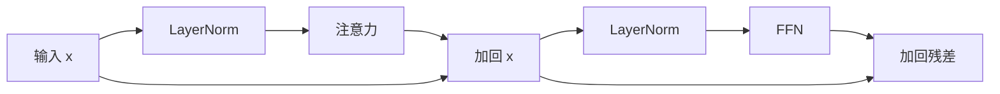
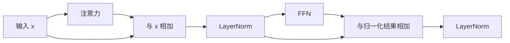

# 第 4 讲：组装多头注意力与 Transformer Block

> [!nav] 页面导航
> [[01_学习指南/08_Transformer从零实现/00 Transformer 从零实现学习地图#学习顺序|单元 08：Transformer 从零实现]] · [[01_学习指南/08_Transformer从零实现/逐讲学习/03 手算归一化前馈网络与残差|上一讲]] · [[01_学习指南/08_Transformer从零实现/逐讲学习/05 给 token 加位置并理解 RoPE|下一讲]]

## 本讲目标与先修知识

先会 Q/K/V 与 mask（[[01_学习指南/08_Transformer从零实现/逐讲学习/01 看懂缩放点积注意力|第 1 讲：看懂缩放点积注意力]]、[[01_学习指南/08_Transformer从零实现/逐讲学习/02 用 mask 阻断不该看的 token|第 2 讲：用 mask 阻断不该看的 token]]），本讲再把单头扩成多头，理解线性层、残差连接、LayerNorm 和前馈网络。最终能画出一个 Block，并区分 Pre-Norm 与 Post-Norm。

首次遇到 LayerNorm／FFN／残差时，先读 [[01_学习指南/08_Transformer从零实现/逐讲学习/03 手算归一化前馈网络与残差|手算与运行详细课]]，完成一条归一化和固定网络的手算，再回本页组装。补充课还检查零子层时 Pre/Post-Norm 的差异。

## 多头注意力在做什么

单头只有一套 Q/K/V 投影。多头注意力把隐藏向量投影成多个较小子空间，让不同头分别学习不同的匹配关系。若隐藏维度 `D_model=12`、头数 `H=3`，每头维度 `D_head=12/3=4`。

过程是：

1. 线性层从输入 `[B,T,D_model]` 产生 Q/K/V。
2. 把最后一维拆成 `[H,D_head]`，转成 `[B,H,T,D_head]`。
3. 每头各自执行上一讲的注意力。
4. 合并头得到 `[B,T,D_model]`，再做输出线性投影。

头数必须整除隐藏维度，否则无法均匀拆分。工程在 [attention.py](../示例工程/app/attention.py) 实现多头投影。

## Transformer Block 的两条支路

注意力负责 token 间信息混合；前馈网络（FFN）在每个 token 内独立变换特征，典型形式是 Linear → GELU → Linear。残差连接把输入加回子层输出，帮助信息与梯度沿深层网络传递。LayerNorm 按单个 token 的特征维度归一化，不跨 batch 统计均值方差。

Pre-Norm 先归一化再进子层：



Post-Norm 则先做子层与残差相加，再归一化：



两种顺序都存在于模型设计中。Pre-Norm 在许多深层训练设置下更容易优化，但不等于永远更好；表现还取决于深度、初始化、学习率等。工程的 `TransformerBlock` 可选两种方式。

## 检查最小形状

`B=2,T=5,D_model=12,H=3` 时，拆头前 `[2,5,12]`；拆头后 `[2,3,5,4]`；每头注意力输出形状不变；合并头后回到 `[2,5,12]`。Block 输入与输出形状相同，这样才能使用残差相加。

打开 [model.py](../示例工程/app/model.py) 对照 `TransformerBlock`，在工程目录执行：

```powershell
..\..\..\.venv\Scripts\python.exe -m pytest tests/test_model.py -q
```

结果应显示模型输出、梯度及两种 Norm 路径的测试通过。

## 常见错误

- 头数不能整除隐藏维度：初始化时应立即报清楚的 ValueError。
- 合并头时维度顺序错：应先把 `[B,H,T,D_head]` 转为 `[B,T,H,D_head]`，再合并最后两维。
- 残差张量形状不同：检查子层输出是否恢复 `D_model`。
- LayerNorm 归一化错维：这里归一化最后的特征维，通常指定 `normalized_shape=D_model`。
- 把 Pre/Post-Norm 说成“谁一定稳定”：它们改变计算图中的归一化位置，稳定性是训练条件共同影响的经验性质。

## 练习

### 跟做练习

输入 `[4,7,24]`，头数 6，写出每头维度和拆头后的形状。答案：每头 4，形状 `[4,6,7,4]`。

### 独立练习

如果隐藏维度是 10、头数是 3，指出哪里不成立。参考：10 不能被 3 整除，不能平均切分；可改头数或隐藏维度，不能悄悄丢掉特征。

### 迁移练习

自己画 Pre-Norm 与 Post-Norm 的残差加法、LayerNorm 顺序，并圈出两者不同的位置。完成标准：对照图能逐步复述数据流，而非只记名字。

> [!example]- 答案解析：为什么 Block 前后形状相同
> 残差连接要求两边元素能逐项相加。注意力输出必须合并回隐藏维度，FFN 最后一层也投影回原隐藏维度，因此每个子层的残差支路保持 `[B,T,D_model]`。

## 继续学习

> [!next] 下一步
> [[01_学习指南/08_Transformer从零实现/逐讲学习/05 给 token 加位置并理解 RoPE|下一讲：给 token 加位置并理解 RoPE]]

> [!info]- 练习与记录
> [[01_学习指南/08_Transformer从零实现/示例工程/README#代码导航|查看源码]] · [[01_学习指南/08_Transformer从零实现/示例工程/README#环境与运行|运行命令]] · [[02_学习记录/01 全课程完成清单#单元 08：Transformer 从零实现|本单元完成清单]]
