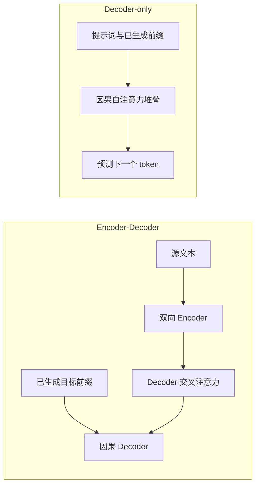

# 第 5 讲：给 token 加位置并理解 RoPE

> [!nav] 页面导航
> [[01_学习指南/08_Transformer从零实现/00 Transformer 从零实现学习地图#学习顺序|单元 08：Transformer 从零实现]] · [[01_学习指南/08_Transformer从零实现/逐讲学习/04 组装多头注意力与 Transformer Block|上一讲]] · [[01_学习指南/08_Transformer从零实现/逐讲学习/06 对齐自回归目标与交叉熵|下一讲]]

## 本讲目标与先修知识

你已了解注意力和多头（[[01_学习指南/08_Transformer从零实现/逐讲学习/01 看懂缩放点积注意力|第 1 讲：看懂缩放点积注意力]]、[[01_学习指南/08_Transformer从零实现/逐讲学习/04 组装多头注意力与 Transformer Block|第 4 讲：组装多头注意力与 Transformer Block]])。本讲回答“相同 token 换个位置，模型如何知道顺序变了？”，并认识 RoPE 的基本旋转机制，以及 Encoder-Decoder 与 Decoder-only 的结构区别。

## 为什么位置信息必要

自注意力对输入位置同时置换时，输出也会相应置换；只靠内容点积，它本身没有“第一个、第二个”的概念。语言顺序改变会改变含义，因此必须把位置信息提供给模型。

常见思路：

- 可学习绝对位置向量：每个位置学习一个向量，加到 token 表示上。
- 正弦位置编码：用不同频率的正弦/余弦表示位置。
- RoPE（旋转位置编码）：按位置旋转 Q、K 的二维分量对，让相对位移影响它们的点积。

类比成指针转过不同角度可以形成相对方向感；实际是对 Q 和 K 的分量对乘以正弦、余弦构成的旋转矩阵。旋转本身不增加向量维度，也不是把 Value 一起旋转。

## RoPE 的最小直觉

把每头向量相邻两个分量 `(x_even,x_odd)` 看作一个二维平面点，位置 p 对它旋转角度 `p×频率`：

```text
x_even' = x_even cos(角度) - x_odd sin(角度)
x_odd'  = x_even sin(角度) + x_odd cos(角度)
```

不同分量对使用不同频率。位置 0 的旋转角为 0，因此向量不变。注意力分数仍来自旋转后的 Q 与 K 点积；这样点积会包含相对位置差的信息。实现要求每头维度为偶数，因为需要两两配对。

打开 [attention.py](../示例工程/app/attention.py) 的 `apply_rotary_position_embedding`，留意输入输出形状相同，位置频率只依赖序列位置和通道索引。运行 RoPE 测试：

```powershell
..\..\..\.venv\Scripts\python.exe -m pytest tests/test_attention.py -q
```

应看到 position 0 的结果与输入一致，形状不变；奇数 head dimension 会明确报错。

## 两种常见 Transformer 外形



Encoder-Decoder 的 Decoder 通过交叉注意力读取 Encoder 输出，常见于翻译式任务。Decoder-only 只堆叠因果自注意力层，通过下一个 token 目标学习续写。本工程只实现 Decoder-only；图中 Encoder-Decoder 是概念对照。

## 动手与排错

1. 在纸上写出两维输入在位置 0 的旋转结果。
2. 写出位置 1、角度为 θ 时的两个输出分量。
3. 阅读实现并检查 Q/K 调用 RoPE 的位置；不要误以为 V 也被旋转。
4. 检查 `head_dim % 2 == 0`，否则无法配成二维分量。

常见错误：把旋转作用到整个模型隐藏维而非每头 Q/K；将奇偶分量配对次序写反；位置频率每次 batch 随机变化。发现位置改变却输出完全一样时，检查 RoPE 是否实际应用到 Q/K。

## 练习

### 跟做练习

对位置 0，θ=0，代入公式说明为何输出等于原向量。标准答案：cos(0)=1、sin(0)=0。

### 独立练习

若隐藏维度 16、头数 4，RoPE 每头处理多少对分量？每头维度 4，所以是 2 对。

### 迁移练习

选一组连续位置，将位置 p 与 p+1 的旋转角写出，并用一句话说明相对差为何是 θ。完成标准：能区分绝对位置参数 p 与两位置之差。

> [!example]- 答案解析：Decoder-only 的训练方向
> 输入前缀经因果掩码后，每个位置只读取当前及之前 token，因此可同时训练许多位置预测“下一个 token”。推理时后续 token 尚不存在，只能生成一个再追加，下一讲和第 7 讲会展开。

## 继续学习

> [!next] 下一步
> [[01_学习指南/08_Transformer从零实现/逐讲学习/06 对齐自回归目标与交叉熵|下一讲：对齐自回归目标与交叉熵]]

> [!info]- 练习与记录
> [[01_学习指南/08_Transformer从零实现/示例工程/README#代码导航|查看源码]] · [[01_学习指南/08_Transformer从零实现/示例工程/README#环境与运行|运行命令]] · [[02_学习记录/01 全课程完成清单#单元 08：Transformer 从零实现|本单元完成清单]]
