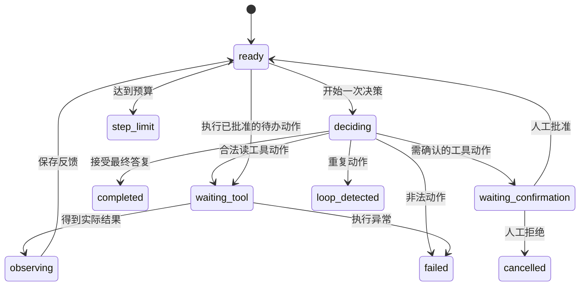

# 第 3 讲：画状态机并实现最小循环

> [!nav] 页面导航
> [[01_学习指南/14_Agent运行原理与状态机/00 Agent 运行原理与状态机学习地图#学习顺序|单元 14：Agent 运行原理与状态机]] · [[01_学习指南/14_Agent运行原理与状态机/逐讲学习/02 保存状态消息与工具观察|上一讲]] · [[01_学习指南/14_Agent运行原理与状态机/逐讲学习/04 设置步数循环检测与取消|下一讲]]

## 要解决什么问题

只有一个while循环还不够：等待确认时能执行吗？已经完成后能继续查吗？工具尚未返回能生成“成功”吗？**状态机**把允许的阶段及其转移写清楚，让程序拒绝不合理顺序。

状态机包含状态、事件和允许转移。状态是“当前在哪个阶段”，事件是“发生了什么”，转移是“事件后进入哪一阶段”。例如tool_started使deciding进入waiting_tool；tool_observation使waiting_tool进入observing。

前置是循环、return和字典/set。集合set用于判断成员是否在允许列表里，`in`返回布尔值。没有要求先会数学形式化状态机。

## 先画正常路径



图先只显示主要边。完整允许集合见 `state.py` 的ALLOWED_TRANSITIONS，取消还可发生在ready和deciding。终态没有后续执行边，避免完成后继续产生副作用。

`waiting_tool`在同步示例里不是后台异步等待：控制器进入该状态后立即调用工具，阻塞到返回。名字描述阶段，不保证存在另一个线程。

## 用枚举避免拼错状态

`Status(StrEnum)`把允许的字符串集中声明，例如Status.READY.value是ready。枚举是“只能从预先列出的名称选择一个值”的类型；StrEnum兼顾字符串表示，适合JSON输出。Python3.11起提供该类型，共享环境3.13可用。

在示例工程新建 `inspect_transition.py`：

```python
from state import AgentState, Status, transition

state = AgentState("演示", "run-1")
transition(state, Status.DECIDING, "decision_started")
print(state.status.value)
print(state.trace[0]["from"], state.trace[0]["to"])
```

预期deciding、ready deciding。transition先检查next_status在当前状态的允许集合中，再追加事件，最后改state.status。若直接ready→completed，会ValueError，因为跳过了决策阶段。不要在源码其他位置随意赋状态绕过检查。

## 先实现只有读工具的最小循环

下面是必要的完整教学脚本，保存为 `minimal_loop.py`。它刻意只展示反馈循环；预算、确认、记录仍以工程run_agent为准。

```python
from tools import lookup_policy

observations = []
for step in range(2):
    if not observations:
        result = lookup_policy({"service": "storage"})
        observations.append(result)
    else:
        result = observations[-1]
        if result.ok:
            print("存储保留：", result.data["retention"])
        else:
            print("没有依据：", result.error_code)
        break
```

range(2)给两次循环，第一次观察为空所以查工具，第二次读取刚刚结果并break。break退出循环；return退出函数，作用范围不同。这段脚本与完整工程的区别是没有独立Action、状态转移和强约束，不应直接拿它运行真实写操作。

## 再顺着完整控制器读

打开 `agent.py` 的run_agent：

1. 校验预算，拒绝从不支持的中间状态继续。
2. 已终态或等待确认时返回当前state。
3. 首次加入用户消息。
4. while在非终态下检查取消。
5. 没有pending_action时检查预算，增加steps，进入deciding。
6. 传state副本给decide，校验Action并处理final/工具分支。
7. 工具需确认则保存pending并返回；读工具则进入waiting_tool。
8. 执行工具，保存实际结果，进入observing，再回ready。

`return state`让调用者看到最终或暂停状态；返回不一定completed。真正等待人工时进程可以保存界面状态，收到批准后再次调用run_agent。当前示例没有跨进程恢复功能，不应把trace文件直接当持久任务调度器。

## ReAct、工作流与状态机怎样联系

**ReAct**论文探索交错的推理与行动，让模型根据环境反馈调整任务。它是一种提示/决策范式，不是Pythonwhile语句本身。见 [ReAct原论文](https://arxiv.org/abs/2210.03629)。本工程规则决策器演示行动反馈机制，未复现论文的模型效果。

**工作流**通常预先安排任务步骤和分支，例如固定“检索→审核→回答”。Agent决策可能更开放，选择下一动作。二者可以结合：外层状态机保证权限/终止，内层模型决定合法范围内的下一步。

这里的日志只需要公开动作、参数、结果、状态和耗时，不需要模型未公开的内部推理。不要要求获得隐藏思维链作为调试前提；可记录简短公开决策说明，但它同样不是工具执行证据。

## 常见错误与练习

工具失败但标completed：如果final明确告知失败，completed可以只表示“对用户完成回复”；业务任务完成率另评估。工具抛异常时状态卡住：应在执行边界记录失败并结束，当前工程捕获已列出的常见异常，未覆盖异常会继续抛出，不能隐藏成成功。

**跟做：** 手画默认trace的状态顺序。完成标准：包含observing和第二次deciding。

**独立：** 判断ready→completed、waiting_confirmation→ready、completed→waiting_tool哪些合法，并说明原因。

**迁移：** 为“查订单→需退款则待确认→执行→报告”画状态机，标出取消和失败边。完成标准：每个有副作用的边都经过控制器确认；终态无继续写入边。

> [!example]- 参考答案与解析
> 默认ready→deciding→waiting_tool→observing→ready→deciding→completed。只有waiting_confirmation→ready合法；ready不能跳过决定完成，completed不可再执行。退款应把被批准的订单号、金额和版本绑定到待办动作，不能把一次批准用于另一个动作。

## 继续学习

> [!next] 下一步
> [[01_学习指南/14_Agent运行原理与状态机/逐讲学习/04 设置步数循环检测与取消|下一讲：设置步数循环检测与取消]]

> [!info]- 练习与记录
> [[01_学习指南/14_Agent运行原理与状态机/示例工程/README#代码导航|查看源码]] · [[01_学习指南/14_Agent运行原理与状态机/示例工程/README#运行|运行命令]] · [[02_学习记录/01 全课程完成清单#单元 14：Agent 运行原理与状态机|本单元完成清单]]
