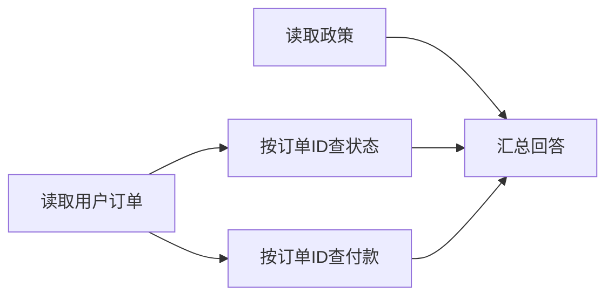

# 第 2 讲：按依赖关系聚合部分结果

> [!nav] 页面导航
> [[01_学习指南/16_并行工具异常处理与可靠性/00 并行工具与可靠性学习地图#学习顺序|单元 16：并行工具与可靠性]] · [[01_学习指南/16_并行工具异常处理与可靠性/逐讲学习/01 从顺序等待走到异步并行|上一讲]] · [[01_学习指南/16_并行工具异常处理与可靠性/逐讲学习/03 为超时重试与退避设置边界|下一讲]]

## 要解决什么问题

先查用户得到订单ID，再查状态；政策查询可以同时进行。结果可能部分成功，两个来源又可能给出相反政策。要按依赖分阶段，并保留错误和冲突。

**依赖**表示B输入来自A输出；**聚合**整理多项实际结果，不能把错误忽略后假称全部完成。

## 先画依赖图



A/D可并行，B/C必须等A成功。A失败不能用虚构ID继续，可保留D结果。Scheduler没有通用DAG（有向无环依赖图）执行器，使用两次run_batch分阶段，更容易看清输入来源。

## 完整两阶段示例

在示例工程创建 `inspect_dependency.py`：

```python
import asyncio
from scheduler import Request, Scheduler, ToolSpec

async def get_order(arguments):
    return {"order_id": "ORDER-1"}

async def get_status(arguments):
    return {"order_id": arguments["order_id"], "status": "open"}

async def main():
    scheduler = Scheduler({
        "order": ToolSpec(get_order, is_read_only=True),
        "status": ToolSpec(get_status, is_read_only=True),
    })
    first = (await scheduler.run_batch([Request("q1", "order", {})]))[0]
    if not first["ok"]:
        print("没有订单ID，停止后续查询")
        return
    order_id = first["data"]["content"]["order_id"]
    second = await scheduler.run_batch([Request("q2", "status", {"order_id": order_id})])
    print(second[0]["data"]["content"])

if __name__ == "__main__":
    asyncio.run(main())
```

预期ORDER-1/open。data.content是短结果包装；若is_summary=True，应先按result_ref回查，第5讲详解。先检查ok再读data，不能对错误结果直接取ID。

## 部分成功怎样回传

每项有call_id、tool_name、ok、data/error、attempts。已知错误转结构化结果，不打断其他独立任务；未知程序异常继续抛出并取消收拢任务，避免隐藏bug。

demo的两份政策成功、第三个工具unknown_tool。聚合failures保留错误ID，is_complete=False。Agent应明确哪些取得、哪些失败，再选择替代或告知；不能说“三项都查好了”。

gather本身不是部分成功协议，_execute负责已知故障包装。return_exceptions=True常用于清理，不能把异常对象直接当普通成功data给模型。

## 冲突不能静默覆盖

同字段retention得到14 days和30 days，merge_facts保留两份source/version到conflicts，并移除可直接使用的retention，不平均成22天，也不选择最后完成那项。

生产可按权威来源、日期、适用范围和版本选择，但规则要明确。demo两份version都1，source名字old/new不证明谁有效。摘要结果未回查会标needs_full_result；缺field/value的数据当前跳过，所以这个聚合器只用于约定的事实工具，不是万能JSON合并。

## 同批重复共享

安全只读/真实幂等工具，同名同参数在同批共享Task，分别回填call_id。非幂等写不自动合并，因为两个参数相同的请求也可能是两次合法独立业务。

共享没有跨批缓存。示例假定整批同授权范围；生产键应含用户/租户/权限/版本，避免把其他身份结果交给当前用户。共享安全不能仅靠参数字面相同判断。

## 常见错误与练习

KeyError订单号：检查第一步ok及summary分支。错配：按call_id关联而非完成位置。矛盾不见了：检查是否后项覆盖前项；保留冲突，不猜真值。

**跟做：** 找两阶段order_id来源，再跑demo查看conflicts/failures。

**独立：** 为“获取文件ID→读正文/权限”画图，说明可并行项、失败时停止项。

**迁移：** 政策和工单查询部分成功时设计说明及重规划。完成标准：只回答已有证据，不给失败字段填猜测。

> [!example]- 参考答案与解析
> ID成功后正文/权限可并行，但正文展示还须等授权；ID失败两项停止。可说“已查到公开政策，工单暂时超时”，然后依据安全重试规则处理。来源冲突需核实适用版本，不能凭返回快慢决定。

## 继续学习

> [!next] 下一步
> [[01_学习指南/16_并行工具异常处理与可靠性/逐讲学习/03 为超时重试与退避设置边界|下一讲：为超时重试与退避设置边界]]

> [!info]- 练习与记录
> [[01_学习指南/16_并行工具异常处理与可靠性/示例工程/README#代码导航|查看源码]] · [[01_学习指南/16_并行工具异常处理与可靠性/示例工程/README#运行|运行命令]] · [[02_学习记录/01 全课程完成清单#单元 16：并行工具、异常处理与可靠性|本单元完成清单]]
