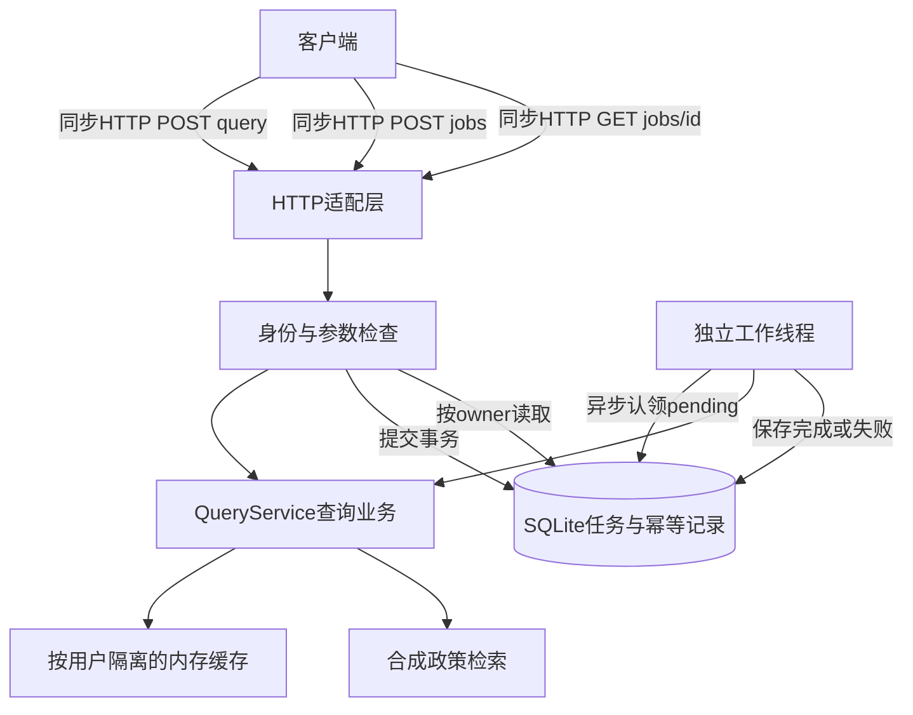

# 第 6 讲：画出系统边界并演练重启恢复

> [!nav] 页面导航
> [[01_学习指南/18_后端网络与系统设计/00 后端网络与系统设计学习地图#学习顺序|单元 18：后端网络与系统设计]] · [[01_学习指南/18_后端网络与系统设计/逐讲学习/05 加入有边界的缓存与任务去重|上一讲]] · [[01_学习指南/18_后端网络与系统设计/00 后端网络与系统设计学习地图#完成后继续|学完继续]]

## 本讲任务与前置

系统设计先把已经存在的调用、数据和失败边界画清楚，再按真实需求扩展。复习本单元HTTP/任务/缓存，单元17备份。本讲做一次恢复演练、估算一个工作线程的处理能力，写出尚未具备的生产能力。

## 先读数据流图



图中的异步表示提交响应和任务执行在不同时间/线程发生，不表示代码一定写async def。每次HTTP收发依然是请求响应；异步任务由持久状态连接起来。当前没有模型、真实检索库或外部工具写入；若接入，应放在业务层后并标明超时/权限边界。

一个进程内按HTTP适配、业务、存储分文件，是分层单体。拆文件已经能让业务测试不启动网络；无需为了学习立刻拆成多个微服务。跨进程会增加网络错误、鉴权、部署、数据一致性和运维成本。

## 最小恢复演练

新建`lesson_restart.py`，只使用自己的临时数据库：

```python
from pathlib import Path
from tempfile import TemporaryDirectory
from service import QueryService
from storage import JobStore

with TemporaryDirectory(dir=Path(__file__).parent) as directory:
    path = Path(directory) / "jobs.sqlite"
    first = QueryService(JobStore(path))
    interrupted, _ = first.submit("alice", "one", "refund")
    first.store.claim_next()
    waiting, _ = first.submit("alice", "two", "support")

    restarted = QueryService(JobStore(path))
    print("标记中断", restarted.store.recover_running())
    print(restarted.store.get("alice", interrupted["job_id"])["status"])
    print(restarted.store.get("alice", waiting["job_id"])["status"])
    restarted.run_one()
    print(restarted.store.get("alice", waiting["job_id"])["status"])
```

预期标记中断1、failed、pending、completed。这里构造新Service模拟重启后的对象与连接，故意保留同一个数据库路径。它不等于操作系统崩溃/断电实验，但验证持久行和恢复策略；测试还验证完成结果重新连接后保留。

recover_running将上次running标为failed并附interrupted_by_restart，不自动重放可能已执行的工作。pending可以继续；completed保留。本例只读查询可以设计人工/新意图重试，但真实外部写不能仅靠状态自动重做。

> [!warning] 单实例约束
> 恢复策略假定同一数据库只有本单元一个活动服务实例。若第二实例启动时把第一实例running都标failed，就会误伤。多实例需要租约、worker身份/心跳、过期判定和结果提交协议，本工程未实现。不要让两个server共用同一个jobs.sqlite同时运行。

## 手动服务重启检查

按第01讲启动server，提交并查到completed，保存job_id。在终端A按Ctrl+C，重新运行同一命令与同一数据库。用原用户GET原ID，应仍completed；query缓存首次应未命中。数据库不是内存字典，缓存清空不影响任务状态。

如果切换`--database`到另一个文件，旧任务404是访问了不同数据库，不是SQLite丢数据。默认路径以server.py所在目录为基准；显式相对database参数按终端当前工作目录解释。备份/恢复先按单元17练；生产备份还需要保留期和恢复演练，不能把存在一个文件当可靠备份。

## 容量估算：先算数量级

假设真实单任务平均耗时0.5秒，一个工作线程顺序处理，理想上限约1/0.5=2任务/秒；扣除DB/调度/长尾会更低。来流量3任务/秒则每秒净积压约1份，持续一分钟积压约60份。增加HTTP请求线程不能自动提高唯一工作线程的处理率。

这只是平均值估算，不是测量结果。还要关注p95延迟、每任务CPU/GPU显存、队列长度、数据库锁等待、超时失败率。模型批处理能改变吞吐和延迟，需要实际负载测量，不可直接按线程数线性乘。

任务队列目前没有最大积压、配额或保留清理。生产接入昂贵模型前至少设计提交限额、队列容量/拒绝状态、截止时间、历史结果保留和用户限流。本例HTTP正文限4096字节、缓存32项只约束这两类资源，不能宣称全系统有界。

## 配置、依赖和扩展顺序

当前只配置port和database，运行依赖标准库。演示令牌明确写在代码，不是秘密。真实凭据需从受控配置/秘密系统读取并避免日志输出；不能把.env当公开教材上传。

后续迁移FastAPI等框架时，可保留QueryService/JobStore，替换HTTP路由和验证适配；需要先批准依赖安装及版本，随后同样跑边界测试。当前没有FastAPI/Uvicorn安装或实测，不把标准库HTTP练习冒充框架教程。

当重复跨进程查询确有成本，考虑共享缓存；当任务耗时长且多个worker确有需求，考虑持久任务系统；当数据库并发受限，评估服务型数据库。每次扩展说明带来的新故障边界，而不以技术名词数量评价系统。

## 常见错误

- 只画模块框，不标同步/异步：无法解释何时请求返回、结果保存在哪里。
- 将failed中断误解成工作绝未发生：可能执行到一半或已完成外部操作；状态只反映本地确认。
- 用health=ok证明依赖全好：当前health只证明HTTP进程能响应，未做数据库/worker可用性检查，不能视为完整ready检查。
- 性能用一次demo毫秒结果推测生产QPS：合成字典极快，必须用目标模型和真实负载单独测。

## 验收练习与答案

跟做：保存恢复脚本四行输出，说明同路径的作用。完成判断：能解释pending与running的恢复为何不同。

独立：给数据流图增加真实模型节点，标出加载位置、推理预算、取消检查和结果持久化。不要在每个请求中重新加载模型。

迁移：写一页部署前报告，包含接口契约、数据隔离、断开重试、重启策略、容量/积压、日志请求ID、明确未实现能力。完成判断：读者不会误以为本地demo已满足公开生产服务要求。

> [!example]- 参考答案与解析
> 同路径保存任务身份与结果；pending未认领可处理，running不能证明副作用安全重放，所以标中断失败。模型在服务生命周期初始化，业务层提交受控推理，超时和取消到工具/模型边界，结果再写回DB。
>
> 报告至少声明：固定演示令牌、仅回环、标准库非生产HTTP、单实例恢复、无队列容量/分布式租约、模拟上游超时、状态取消不抢占、无SSE/WebSocket/Redis、未测试真实模型或真实网络。优先把需求和测量补上，再决定扩展。

## 单元结束后

从[[90_参考与维护/单元验证/18 后端网络与系统设计验证记录|作者验证记录]]核对实际执行范围，自己完成后再在学习记录勾选。下一单元评估Agent的任务成功、工具轨迹、成本和安全边界。

## 继续学习

> [!next] 下一步
> [[01_学习指南/18_后端网络与系统设计/00 后端网络与系统设计学习地图#完成后继续|本单元完成后继续]]

> [!info]- 练习与记录
> [[01_学习指南/18_后端网络与系统设计/示例工程/README#代码导航|查看源码]] · [[01_学习指南/18_后端网络与系统设计/示例工程/README#运行|运行命令]] · [[02_学习记录/01 全课程完成清单#单元 18：后端、网络与系统设计|本单元完成清单]]
