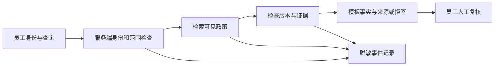

# 第 6 讲：写出 MVP 与两周迭代计划

> [!nav] 页面导航
> [[01_学习指南/23_需求到技术方案/00 需求到技术方案学习地图#学习顺序|单元 23：需求到技术方案]] · [[01_学习指南/23_需求到技术方案/逐讲学习/05 计算模拟收益并定义停止条件|上一讲]] · [[01_学习指南/23_需求到技术方案/00 需求到技术方案学习地图#完成后继续|学完继续]]

## 本讲任务与前置

形成别人可以评审的MVP方案与两周计划。MVP意为最小可验证版本：保留足够功能检验核心需求；必须保留所选范围的权限、错误处理和验收。不是把可靠性都推迟以后补。前置是本单元前五讲的场景、约束、选项、指标与收益假设。

两周在本例指十个工作日的模拟安排，不是你的真实日程，也不是完成承诺。夹具只有30人时，每天最多4小时；发现关键前提不成立就停止或重排，不把计划当已完成进度。

## MVP的明确边界

本轮包含固定公开政策来源/版本、员工只读查询与来源引用、无证据拒答、固定评估和越权边界、日志报告、单实例本机接口。排除真实退款/账户写入、任意代码或公网部署、GPU微调、多实例分布式任务、替人工承担业务承诺。

把边界写出来，是为了具体测试和估算。本轮没有做神经模型训练；以后课程进入GPU训练/微调时要按相应目标、设备与版本检查，而不会因本例GPU0就停止学习。

## 结构与数据流



箭头表示数据/执行关系，不是证明系统已经存在。身份从受信应用取得，用户输入和文档正文不能授予权限。日志不写原始秘密；资料更新需维护者审核来源。系统只读取资料，员工负责最终答复。每个节点都有失败处理，不能只画成功箭头后忘记失败契约。

## 十个工作日怎样安排

| 日 | 人时 | 交付物 | 完成判断 |
|---|---|---|---|
| D01 | 2 | 场景、假设、范围 | 角色/失败分支/待证项清楚 |
| D02 | 3 | 合成资料与评估草案 | 来源/版本、预期结果可复查 |
| D03 | 3 | 导入机制 | 拒绝无效记录，可追踪版本 |
| D04 | 3 | 检索基线 | 同义/缺资料用例有结果 |
| D05 | 3 | 权限边界 | 跨范围输入无未授权读取 |
| D06 | 3 | 模板与引用 | 事实有来源，冲突不编造 |
| D07 | 3 | 本机接口 | 输入校验、错误契约可运行 |
| D08 | 3 | 指标与成本记录 | 分母/版本/假设完整 |
| D09 | 4 | 联调与故障回归 | 正常/失败/边界证据齐全 |
| D10 | 3 | 演示与交接/决策 | 复现步骤、限制、下一步明确 |

总和30人时，每日不超4。顺序依赖的含义是前一步的产物支持下一步，例如不知道资料格式就难以完成导入。这里给定一条顺序链，真实工作可以并行，但人员/依赖/审查时间需要重新计算。30小时全部分配，没有缓冲；评审时必须把这作为风险说明，不能声称计划很稳。

## 动手：运行整份方案检查

VS Code打开示例工程终端，运行：

```powershell
& ..\..\..\.venv\Scripts\python.exe demo.py
```

`demo.py` 从脚本位置读取夹具，调用结构验证，再演算基准与低成功率收益。预期方案摘要为8个技术子问题、10个工作日、30人时、预算100/估算20；基准净28.750、低成功率净−6.250；待证假设为A01、A02、A03。字典展示顺序可随修改变化，检查数值和状态而不是截图完全一致。

这份代码没有建立客服接口、SQLite政策库或真实客户收益报告。它让方案中的计算和依赖矛盾可以提前发现。实际实现要按每日产物另做功能和失败用例，不能将计划检查的15项测试称为客服系统验收。

在 Obsidian 打开 [[01_学习指南/23_需求到技术方案/模拟客服知识助手技术方案|可评审方案]]，对照逐讲说明。保存自己的评审备注，明确哪些条目同意、哪些需要证据、哪个假设应优先验证。

## 故意制造一项计划失败

新脚本读取夹具，在内存中把D01的 `depends_on` 改成 `["D02"]`，调用验证，预期“依赖必须指向此前已安排步骤，不能循环或倒置”。原因是D01还没开始就依赖后面的产物。修复应调整真正的工作顺序或拆产物，不能删除所有依赖让检查失去意义。

完整练习保存为 `lesson_dependency.py`，仍用共享解释器运行：

```python
import json
from pathlib import Path
from planning import validate_plan

plan = json.loads(
    (Path(__file__).parent / "fixtures" / "plan.json").read_text(encoding="utf-8")
)
first_day = plan["milestones"][0]
first_day["depends_on"] = ["D02"]
try:
    validate_plan(plan)
except ValueError as error:
    print("预期失败：", error)
else:
    raise AssertionError("前向依赖意外通过")
```

`[0]`取列表第一项D01，不是第零个工作日；Python索引从0开始。`first_day`引用这个工作日的同一个字典，因此改字段会影响内存方案。预期打印依赖顺序失败；不修改原夹具，也不把失败标成完成了D01。

## 常见错误与处理

“开发完成”无判断标准：写产物、操作、预期结果及失败情形。计划还没执行就勾选完成：学习记录与方案里分别保留未完成、未验证状态。最后一日才发现无法获得资料：把授权放在D01/D02作为停止条件。全部时间被功能吃满：优先缩小功能范围，保留验证与交接，给真实计划重新留缓冲。

## 最终练习

跟做：检查十日小时数及最大值。独立：把自己的一页方案交给“没参与编写的人”视角审阅，列三处缺证据项。迁移：选一个自己的内部查询场景，写至少五个技术问题、每个两候选、资源/数据/人员约束、MVP边界、验收和两周安排。

> [!example]- 参考答案与过程
> 十日合计30，最大4。缺证据项可以是查询量、复核时长、范围内任务成功率；每项写验证方法和改变决策的条件。迁移方案可沿本例结构，但必须重新调查角色、资料使用权和任务分布，不能复制30小时/90%来冒充适合自己。若增加写入能力，补确认、幂等和恢复验收，并重排预算与人时。

完成判断：可以独立解释“为什么这个MVP足以验证目标、为什么排除某项、怎样判断不值得继续、下一轮先验证什么”。接着进入 [[01_学习指南/24_FDE需求协作演示与交付/00 FDE需求协作演示与交付学习地图|单元24：FDE需求协作、演示与交付]]。

> [!nav] 路线续读
> 若本讲已到当前路线列出的范围末尾，返回原阶段继续下一项或检查产物；继续单元学习时沿下方“下一讲”。
>
> - [[00_学习路线/06 学习需求分析与项目交付#阶段 4：演示与交接|学习需求分析与项目交付 · 阶段 4：演示与交接]]

## 继续学习

> [!next] 下一步
> [[01_学习指南/23_需求到技术方案/00 需求到技术方案学习地图#完成后继续|本单元完成后继续]]

> [!info]- 练习与记录
> [[01_学习指南/23_需求到技术方案/示例工程/README#代码导航|查看源码]] · [[01_学习指南/23_需求到技术方案/示例工程/README#从这里运行|运行命令]] · [[02_学习记录/01 全课程完成清单#单元 23：需求到技术方案|本单元完成清单]]
