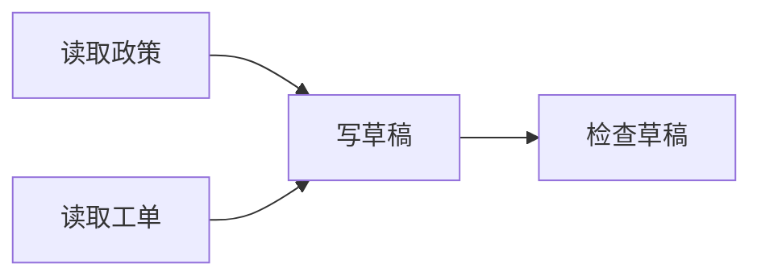

# 第 2 讲：用DAG依赖安排并行与执行顺序

> [!nav] 页面导航
> [[01_学习指南/29_规划工作流与重新规划/00 规划工作流与重新规划学习地图#学习顺序|单元 29：规划工作流与重新规划]] · [[01_学习指南/29_规划工作流与重新规划/逐讲学习/01 把业务目标拆成有输入输出的步骤|上一讲]] · [[01_学习指南/29_规划工作流与重新规划/逐讲学习/03 保存检查点并从已完成步骤继续|下一讲]]

## 本讲要解决的问题与前置

依赖决定顺序，无依赖步骤可以并行。本讲运行DAG并拒绝环。前置上讲节点字段、[[01_学习指南/16_并行工具异常处理与可靠性/00 并行工具与可靠性学习地图|并行与异常]]。

## DAG、就绪节点与图

DAG是有向无环图：箭头表示结果依赖，不可绕回自身。A等B、B等A时谁也无法开始，执行前就应拒绝。每轮找未完成且needs全在completed中的节点，叫就绪节点；本例最多同时执行2个。



如果当前阅读器不显示图，也可按“policy/ticket→draft→review”理解。图描述依赖，不代表网络或GPU结构。

## 最小示例与操作

工程新建lesson_02.py：

```python
from demo import load_scenarios
from workflow import run_workflow

scenario = load_scenarios()[0]
state = run_workflow("plan_execute", scenario)
for event in state["trace"]:
    if event["event"] == "dispatch":
        print("本轮节点：", event["nodes"])
print(state["status"], state["attempts"])
```

运行 `& ..\..\..\.venv\Scripts\python.exe lesson_02.py`，预期[policy,ticket]、[draft]、[review]，completed/4。只是该固定合成任务完成，不能写成真实业务交付。

## 逐步讲解

validate_plan核对字段、ID唯一、工具白名单、依赖存在和发布门，再计算依赖可达集合；不能完成所有节点就报环。`set(needs) <= completed_ids`表示依赖集合的每个元素都具备，不是比较数字大小。

ThreadPoolExecutor(max_workers=2)设线程上限，submit提交函数，as_completed按实际完成次序取结果。结果顺序可能变，应按节点ID使用，不将第一个结果硬当政策。主线程写状态，工作线程只拿依赖副本。

作者测试让两个读取工具在Barrier汇合；如果串行，第一个等不到第二个就超时。Barrier是等待指定线程数量都到达的同步点，仅测试并行，不是业务函数必要步骤。当前工具很小，没有真实上游网络，不用这个演示声称加速比例。

## 沿输出手算执行过程

第一个 `[0]` 取场景列表的首项，也就是正常合成场景；这是一种夹具选择，换列表顺序会改变场景。`run_workflow` 返回状态字典。`trace` 是按发生顺序记录的事件列表，`dispatch` 表示把节点交给工具执行，`completed` 事件表示某一个节点完成，两者不同。

开始 `completed` 为空，policy 和 ticket 的空依赖都满足。两份结果收齐后，draft 才满足依赖。草稿完成后 review 才就绪。最后的 `status="completed"` 是整个任务终态，而 `state["completed"]` 是各节点成果的字典；相同单词出现在不同位置，要结合字段理解。

Python 中 `if event["event"] == "dispatch":` 只打印调度事件，因此你会看到三轮而不是所有日志。四次尝试来自第一轮 2 次、后两轮各 1 次。两个读取谁先返回可以变化，调度分组和依赖条件应保持一致。

### 独立操作的具体完成标准

在自己的笔记画四个方框，先连依赖，再遮住输出手算三轮。随后改环并调用校验器，检查错误应出现“无环/循环”相关信息；修复后原始任务应恢复四次尝试。改错计划的实验放在自己的练习脚本，不修改公共夹具以免后续各讲结果一起变化。

如果出现 `KeyError`，先查看是哪个键缺失；不要用空字典替代失败结果。若 `ModuleNotFoundError: workflow`，检查文件位置及终端目录。若运行一直等待，停止自己的进程，检查是否改了工具函数；校验正确的固定小任务应迅速结束。


## 动手：构造环再恢复

复制make_plan结果，把policy.needs改[review]，validate_plan应拒绝；恢复后成功。再把draft依赖改missing，应拒绝不存在ID。不能删依赖绕过问题，因为会改变业务语义。

常见错误：草稿提前运行读不到资料；无环验证遗漏导致等待；用列表位置当身份；线程无限开；吞掉失败继续拼接空结果。真实工具还需资源/时间界限，线程取消不能强杀不可中断调用，复习单元16。

### 跟做：解释三轮

完成标准是2个并行读取、1个草稿、1个检查。

> [!example]- 参考答案与解析
> width只是上限，后两轮各只有一个就绪节点，不为凑并行运行依赖没满足的步骤。

### 独立：环为何没有开始点

用policy→review→draft→policy说明。

> [!example]- 参考答案与解析
> 三者各等另一未完成结果，即使ticket独立完成，剩余也无法启动。必须修正设计，不在运行时无限重试。

### 迁移：两个工具改同一订单

输入独立就能并行吗？

> [!example]- 参考答案与解析
> 还可能副作用冲突，需要事务/幂等/资源依赖。图要反映业务约束，不只看函数参数。

## 继续学习

> [!next] 下一步
> [[01_学习指南/29_规划工作流与重新规划/逐讲学习/03 保存检查点并从已完成步骤继续|下一讲：保存检查点并从已完成步骤继续]]

> [!info]- 练习与记录
> [[01_学习指南/29_规划工作流与重新规划/示例工程/README#代码导航|查看源码]] · [[01_学习指南/29_规划工作流与重新规划/示例工程/README#先运行|运行命令]] · [[02_学习记录/01 全课程完成清单#单元 29：规划工作流与重新规划|本单元完成清单]]
