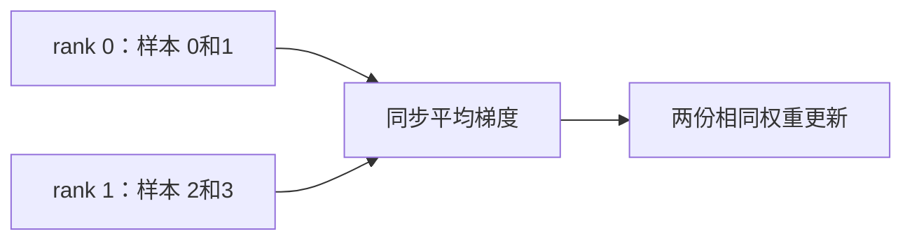

# 第 5 讲：用两个CPU进程读懂DDP梯度同步

> [!nav] 页面导航
> [[01_学习指南/36_长上下文显存与分布式训练/00 长上下文显存与分布式训练学习地图#学习顺序|单元 36：长上下文显存与分布式训练]] · [[01_学习指南/36_长上下文显存与分布式训练/逐讲学习/04 观察位置缩放和滑动窗口的边界|上一讲]] · [[01_学习指南/36_长上下文显存与分布式训练/逐讲学习/06 估算分片显存并设计多卡与保存方案|下一讲]]

## 本讲任务与前置

启动两个 CPU 进程，完成一次真实 DDP 更新，再核对单进程全批次参考。需要参数、梯度、优化器以及均值；不知道进程时把它理解为操作系统中独立运行的一份程序，它与普通函数调用不同。

完成标准：自己的新报告 world_size=2、每进程 2 样本、全局 4 样本，两个进程更新后权重相同，并与参考一致；知道它不是双 GPU 测速或显存分片。

## 要解决什么问题：多份模型如何学成一份

数据并行让多份相同模型处理不同数据，再合并梯度，同步更新。DDP 是 DistributedDataParallel（分布式数据并行）；它复制模型，每个进程处理一份数据，反向时协调梯度，不自动切分参数，也不自动为你划分所有输入。

rank 是进程在组里的编号，world_size 是组大小；本例 rank=0、1。Gloo 是通信后端，负责这些进程交换张量；NCCL 是常见 NVIDIA GPU 通信后端。本机 Windows Gloo 可用、NCCL 不可用，示例采用两个 CPU 进程，避免把单卡冒充多卡。

## 概念与直觉：平均梯度

两人各解两题，最后合并学习反馈；实际是每个进程对本地均值损失求梯度，再同步平均。本地批次大小相等时，“两份本地均值梯度的平均”对应四题整体均值梯度。每人处理数量不等时，直接平均本地均值可能不等于全局样本均值，需要明确加权或数据补齐策略。



本例线性模型只有两个权重，输入两维、输出一维，无偏置。初始 [0.5,-0.25]，SGD 学习率 0.1，均方误差损失。小模型足以观察同步过程，不需要昂贵全参数训练。

## 动手操作：真实双进程实验

在本单元示例工程 PowerShell 运行：

```powershell
..\..\..\.venv\Scripts\python.exe distributed_demo.py --output-dir report-my-ddp-01
```

脚本用 main 入口启动两个子进程，在系统自有临时目录创建通信会合文件；会合表示各进程先约好属于同一个通信组。使用完成自动清理自己的临时目录，不删除学习者的旧报告。

预期输出 world_size=2、local_samples=2、global_samples=4、max_abs_difference=0.0，参考权重的两个值约为 0.9875、0.1625。新目录有 rank-0.pt、rank-1.pt 与 report.json。两份是重复模型权重，不是模型分片，也不是完整续训检查点。

## 最小示例：读取执行结果

新建 `lesson_05.py`，先执行上面命令：

```python
import json
from pathlib import Path

with (Path("report-my-ddp-01") / "report.json").open(encoding="utf-8") as file:
    report = json.load(file)
print(report["world_size"], report["local_samples"], report["global_samples"])
print(report["reference_weights"])
print(report["max_abs_difference"])
print(report["checkpoint_scope"])
```

```powershell
..\..\..\.venv\Scripts\python.exe lesson_05.py
```

预期第一行 `2 2 4`、第三行 `0.0`；权重最后小数因浮点显示可为 0.9875000119 等。最后字段明确是两份复制权重，不能把文件名中的 rank 当成分片证据。

## 逐步读训练顺序

打开 [distributed_demo.py](../示例工程/distributed_demo.py)。父进程 `multiprocessing.spawn` 启两个 worker；每个 worker 先 init_process_group，以相同会合位置、不同 rank、相同 world_size=2 形成组，超时 30 秒。

每个进程构造相同初始模型并用 DDP 包装。`slice(rank*2,(rank+1)*2)` 给 rank0 前两题、rank1 后两题，显式分数据；没有默认所有进程重复全部四题。然后 train、zero_grad、前向、本地均值损失、backward、step。DDP 在反向协调梯度，step 后两份权重相同。

每进程保存自己权重，barrier 表示都到达该点再继续；最后销毁组释放通信资源。父进程等待子进程完成，单独对全部四题做一次相同 SGD 更新，读取两个文件并比较最大绝对差；不一致立即报错，不把文件写出来当同步成功。

按 [PyTorch 2.14 DDP 文档](https://docs.pytorch.org/docs/2.14/generated/torch.nn.parallel.DistributedDataParallel.html)核对机制；当前示例无真实 GPU 同步速度或跨机网络测试，也没有 DataLoader 的自动采样器。

## 保存与恢复的边界

rank 文件只保存模型状态、rank/world_size 与完成步数。未保存优化器、随机状态、数据位置或完整恢复协议，因此用途写成 replicated_DDP_weights_not_sharded_checkpoint_or_exact_resume。两份权重重复是 DDP 的模型副本，不是 FSDP/ZeRO 分片。

真实 DDP 常由指定 rank 保存一份可恢复状态；其他 rank 按协调协议读入，但保存前必须保证步数与状态一致。分片训练的保存方式不同，第 6 讲讨论设计。本例文件可核对一步更新，不声称等价续训。

## 常见错误与排查

启动后通信超时：查看最早子进程错误，核对后端、会合位置、world_size、各进程是否都启动，不无限等待。Windows 原生 FileStore 在本次中文工作区路径上首次报 No such file or directory，改用系统临时目录的自有会合文件后成功；不因此重命名工作区或更换系统 Python。

重复运行目录已存在：换新名，保留失败与成功记录。少一个 rank 文件表示运行没完整完成，不能仅凭另一个文件通过验收。若两进程都用全部数据，可能权重一致但没有实现期望的数据划分，检查 local/global 样本范围。设备和进程数不同概念，CPU 双进程不等于双 GPU。

## 分级练习与答案解析

### 跟做练习：数据归属

在源码标出 rank0、rank1 的索引范围，解释 global_samples=4。提示：slice 右边界不含。

> [!example]- 参考答案
> rank0 为 [0,2)，rank1 为 [2,4)，各两题、合起来四题。完成标准：不把两个进程各全批次误写成八条独立样本。

### 独立练习：DDP 是否省参数显存

模型与优化器状态单卡放不下，只增加 DDP 卡数就一定可行吗？

> [!example]- 参考答案
> 不一定，DDP 每卡复制完整参数／状态。可以减少本地批次激活，但状态过大时需评估分片、参数高效训练等策略。完成标准：指出 DDP 主要分数据，不把总显存简单相加。

### 迁移练习：不等量本地均值

rank0 一题，rank1 三题，简单平均两份均值梯度会给两组怎样的权重？

> [!example]- 参考答案
> 两组各占一半，rank0 的单题权重过大；全局逐题均值应按1/4与3/4分组加权，或设计均衡批次与相应损失归约。完成标准：说明当前演示仅验证等量本地批次，不直接推广全部数据分布。

## 继续学习

> [!next] 下一步
> [[01_学习指南/36_长上下文显存与分布式训练/逐讲学习/06 估算分片显存并设计多卡与保存方案|下一讲：估算分片显存并设计多卡与保存方案]]

> [!info]- 练习与记录
> [[01_学习指南/36_长上下文显存与分布式训练/示例工程/README#代码导航|查看源码]] · [[01_学习指南/36_长上下文显存与分布式训练/示例工程/README#环境与运行|运行命令]] · [[02_学习记录/01 全课程完成清单#单元 36：长上下文、显存与分布式训练|本单元完成清单]]
