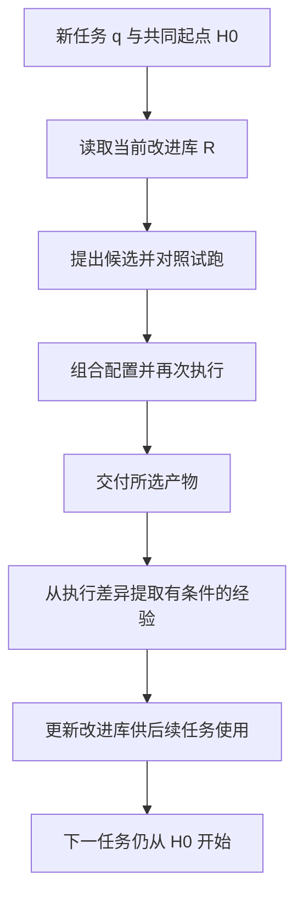

# 理解 Harness 平方的两层改进

> [!nav] 页面导航
> [[01_学习指南/39_Agent_Harness架构实战/00 Agent Harness架构实战学习地图#学习顺序|单元 39：Agent Harness架构实战]] · [[01_学习指南/39_Agent_Harness架构实战/逐讲学习/07 分开检查执行完成与答案正确|上一讲]] · [[01_学习指南/39_Agent_Harness架构实战/选修专题/02 跟着对照试跑理解配置改进流程|下一讲]]

> [!info] 选修专题
> 主线完成后按需要阅读，不计入首次学习的必做课次。

## 今天先学什么

先画出“负责做任务的配置”和“负责改进配置的经验库”两个框。学完后，你应该能解释：一个任务完成后，究竟哪些东西会带到下一个任务，哪些不会自动继承。

前置：本单元第 1～7 讲，尤其是第 7 讲对执行和质量的区分。论文阅读方法可回看 [[01_学习指南/37_论文精读与技术趋势判断/逐讲学习/02 从方法中提取可核对的主张|主张与证据]]。不需要先学 PPO、GRPO 或模型微调。

论文阅读分三篇：本篇看架构；下一篇走一遍算法；第三篇核对实验、成本和适用边界。之后通过 [[01_学习指南/39_Agent_Harness架构实战/选修专题/04 用本地对照实验检查配置修改|本地对照实验]]观察手工配置的行为差异。数学符号只用于指明“哪一项在变化”，不要求背公式。

## 论文身份与阅读范围

- 题目：*Harness²: Recursive Agent Harnessing for an Open World*，本文用“口语化的 Harness 平方”指代它。
- 作者：Ruiyao Xu、Yanfei Chen 等，作者单位包括 Northwestern University 与 Google Cloud AI Research。
- 固定阅读版本：**arXiv:2610.14224v1**；arXiv 记录提交于 **2026-10-09**，本指南核对日期为 **2026-10-23**。这里将其作为预印本研究阅读，不据此宣称已经同行评审。
- 来源：[版本记录](https://arxiv.org/abs/2610.14224v1)、[HTML 全文](https://arxiv.org/html/2610.14224v1)、[PDF](https://arxiv.org/pdf/2610.14224v1)、[作者代码仓库](https://github.com/google-research/harness2)。
- 三篇教程根据正文方法、实验与相关附录改写讲解；论文标注 **CC BY 4.0**。下文的中文解释、练习和本地例子是教学改编，不是作者原文或实验复现。原作者贡献与原始结果均归属原论文。

## 它要解决什么问题

假设模型已经能理解任务，却经常出现这样的行为：文件写完后不重新打开检查；工具调用失败后只原样重试；把大段中间结果全部塞进上下文。更换模型可能有帮助，但也可以检查围绕模型的工作方式。

harness 是让模型能够持续执行任务的一组外部配置与机制，包括提示、工具说明、记忆、技能、脚本、角色分工和执行控制。harnessing 在本文中指改进这套配置的过程。论文把模型参数固定，只修改这层外部系统。[定位：§1、§2.1](https://arxiv.org/html/2610.14224v1#S2.SS1)

“开放世界”在这里指任务在设计 harness 时没有被逐一预见，后续任务的要求和环境可能变化。它不表示模型可以无限访问外部系统，也不表示任务真的没有任何可检查要求。

论文关注两个困难：当前任务没有标准答案反馈可供改进器反复刷分；某次任务中好用的配置又未必适合下一次任务。因此，需要同时研究当前配置怎么改、跨任务经验怎么积累。

## 八类组件分别改变什么

下表是对论文 Figure 2 与 Appendix D.3 Table 5 的中文解释。编号沿用论文；这是该研究采用的一种分解方式，不是所有 Agent 系统都必须采用的标准。

| 编号与组件 | 何时发挥作用 | 用通俗例子理解 |
| --- | --- | --- |
| C1 系统提示 | 每次调用进入上下文 | 先盘点输入，再执行，再检查产物 |
| C2 行为约束 guardrails | 每次调用进入上下文 | 明确哪些资料只读、哪些条件必须满足 |
| C3 记忆 memory | 作为持续可读的文本 | 保存带范围和来源的领域知识 |
| C4 工具使用指导 | 每次调用进入上下文 | 解释什么时候用工具、怎样读错误结果 |
| C5 子 Agent | 委派时建立独立上下文 | 给工作者限定问题，只收回有关结果 |
| C6 技能 skills | 满足触发条件时按需读取 | 需要跨表核对时加载相应步骤 |
| C7 脚本 scripts | 被调用时执行 | 用程序完成确定性的清洗、转换或核对 |
| C8 中间件插件 | 在工具调用或回合边界介入 | 截断噪声输出、检测机械性条件、提示未完成产物 |

来源：[§2.1 与 Figure 2](https://arxiv.org/html/2610.14224v1#S2.SS1)、[Appendix D.3](https://arxiv.org/html/2610.14224v1#A4.SS3)。

**要特别区分文本约束和程序强制。** 论文的 C2 是提供给模型的文字；C8 是插入运行循环的代码。一个文件叫 `guardrails.md` 不会自动拥有操作系统权限控制能力。我们单元 39 的批准检查位于运行程序中，不能仅靠把提示写得更强硬来替代。

按需读取技能可以减少其正文持续占用上下文，但发现技能、触发说明、实际调用与维护仍有成本。“按需”不能解释成整个组件完全免费。

## 两层改进：当前任务与后续任务

论文用以下符号描述系统：

| 符号 | 含义 | 本文是否更新 |
| --- | --- | --- |
| M | 执行模型及其参数 | 固定 |
| H₀ | 每个新任务开始时的共同执行配置 | 作为共同起点 |
| H | 当前任务正在改进的执行配置 | 任务内可以变化 |
| Rₜ | 第 t 个任务使用的改进配置，包含经验库 | 该任务内固定，任务结束后更新库 |
| qₜ | 当前任务 | 外部给定 |

**第一层：任务内改进。** 针对 qₜ，观察 H 的执行表现，提出候选修改，试跑，再形成后继配置 H′。本任务内 Rₜ 保持固定。

**第二层：跨任务改进。** 任务完成后，回看修改与试跑记录，保留有证据支持的经验及采用的可执行配置，更新为 Rₜ₊₁。下一个任务从 H₀ 起步，改进时可以查阅 Rₜ₊₁，按需复用组件；不会直接把上一个任务整套定制配置当作新起点。



这是一张本指南绘制的流程简图；候选选择和递归预算的细节在下一篇补齐。论文定位：[§2.1～2.3](https://arxiv.org/html/2610.14224v1#S2)。

“递归”在这里强调前一次产生的配置、轨迹或经验会影响后续改进，不要求 Python 函数必须调用自身。论文实现中持续变化的是经验库；模型权重、阶段指令与决策规则保持固定。不能扩大成“整个改进程序会无限自主重写”。

## 用本地退款任务理解迁移边界

以下是**本指南构造的例子**，没有运行真实模型，也不是论文报告的案例。

当前退款任务的轨迹显示：已有 `save_note` 回执，但未核对 SQLite 正文。可以提出程序侧检查，使它重新读取实际笔记，并与批准动作核对。完成后，一条可迁移经验可以是：

```text
适用情境：工具返回写入成功，但产物是否可用尚未检查。
改进位置：工具后的验证步骤或机械检查脚本。
经验：从真实存储重新读取产物，核对内容与请求一致性。
证据：哪些执行记录出现了遗漏，修改后哪些具体行为改变。
限制：此步骤不能证明自由文本的全部语义正确。
```

“本商店退款期限为 30 天”则是带业务范围的事实，不能直接推广到其他商店。经验库既可以保留可执行组件，也可以保留应用条件和证据；复用时仍需核对新任务资料。

## 动手：画一张四格阅读卡

在 Obsidian 打开 [[02_学习记录/00 我的学习记录|我的学习记录]]，在个人实际记录区域写以下四项，不必创建新的正式教材文件：

1. 本文更新的对象是什么？
2. 任务内保持不变的对象有哪些？
3. 任务结束后保留什么？
4. 下一任务从哪一个执行配置开始？

预期结果：能够不看论文写出 M 固定、H 可变、R 在任务内固定且任务后更新、下一任务以 H₀ 起步。完成后用 §2.3 逐项对照，标明自己最容易混淆的一项。

## 练习与解析

### 跟做：分类一次修改

给模型增加一段“生成后重新打开文件”的说明，是否等于训练模型权重？

> [!example]- 答案
> 没有改变模型权重；这是修改执行配置里的程序指导。它是否让模型实际执行检查，还需要看轨迹。若把检查写成程序强制步骤，改变的仍是运行系统，但执行机制与提示说明不同。

### 独立：给三种动作选组件

输入总有相同日期格式需要转换；复杂表格任务需要专门的核对步骤；每次工具输出过长挤掉上下文。分别考虑什么组件，为什么？

> [!example]- 答案
> 确定性日期转换可用脚本；满足触发条件的表格核对步骤可用技能；反复出现的过长工具输出可研究中间件处理。还要明确日期歧义、技能何时加载、截断是否丢证据。组件选择只是设计假设，必须观察修改后的行为，不能按名称宣布有效。

### 迁移：哪些经验应该带走

上一次任务使用“列 A 的值除以 100 转为元”成功，能否让以后所有表格都这样处理？

> [!example]- 答案
> 不能。可以保留“先核对字段单位，再显式转换并记录原值”的操作经验；具体列名、单位和除数应以新任务证据确定。若保存了旧脚本，应附适用条件并验证后再复用，不能因为它曾被采用就认为通用。

## 常见误读与完成标准

- 把 H 与 R 都叫“记忆”：要分别指出谁负责执行、谁用于指导修改。
- 把下一任务起点理解为上次最终 H：回看 H₀ 的定义。
- 把八组件看作八个 Agent：只有子 Agent 组件增加独立推理上下文，其他组件职责不同。
- 把论文中的角色设置当成本指南已部署：阅读与数字核对不等于部署；后续本地对照实验也只是手工候选的确定性程序。

能画两层改进、区分八类组件的职责、说明经验的适用范围后，进入 [[01_学习指南/39_Agent_Harness架构实战/选修专题/02 跟着对照试跑理解配置改进流程|下一篇]]。

## 继续学习

> [!next] 下一步
> [[01_学习指南/39_Agent_Harness架构实战/选修专题/02 跟着对照试跑理解配置改进流程|下一讲：跟着对照试跑理解配置改进流程]]

> [!info]- 练习与记录
> [[01_学习指南/39_Agent_Harness架构实战/示例工程/README#代码导航|查看源码]] · [[01_学习指南/39_Agent_Harness架构实战/示例工程/README#从哪里运行|运行命令]] · [[02_学习记录/01 全课程完成清单#扩展单元 39：Agent Harness 架构实战|本单元完成清单]]
