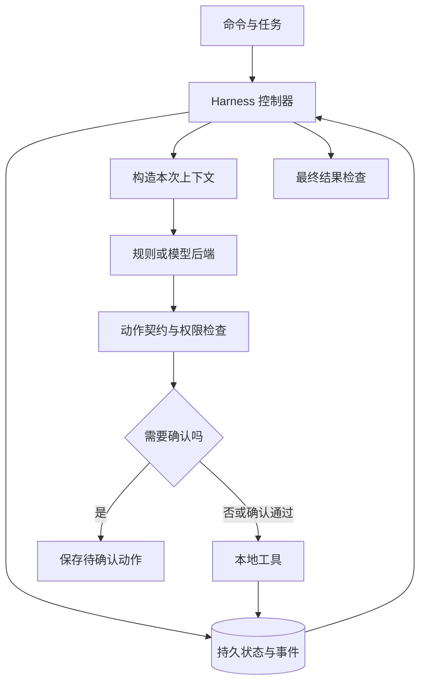

# 第 1 讲：把模型工具状态连接成完整系统

> [!nav] 页面导航
> [[01_学习指南/39_Agent_Harness架构实战/00 Agent Harness架构实战学习地图#学习顺序|单元 39：Agent Harness架构实战]] · [[01_学习指南/39_Agent_Harness架构实战/逐讲学习/02 校验模型动作并预留真实模型接口|下一讲]]

## 要解决什么问题

只调用模型一次，得到的是一条回答。任务若需要“查政策、保存笔记、回答并说明来源”，还要有人负责接收动作、调用工具、保存结果、判断下一步和停止。**Harness** 在这里指驱动这些步骤的执行程序。它像控制台，但实际机制是函数调用、状态转换、数据校验与存储，不会自动让模型变聪明。

先完成地图中的状态机和 SQLite 前置。本节只做一次查询，不要求同时理解整个工程。术语“后端”表示提供决策的实现；本节的后端是规则函数，后面可换成本地模型。

## 六个组件各做什么

| 组件 | 本例文件 | 负责什么 |
|---|---|---|
| 入口 | `demo.py` | 读取命令和会话路径 |
| 契约与上下文 | `contracts.py` | 定义允许的动作，组织模型可见资料 |
| 决策后端 | `backends.py` | 根据输入提议下一步 |
| Harness 控制器 | `runtime.py` | 检查预算、验证、等待确认、执行或停止 |
| 持久存储 | `storage.py` | 保存会话状态、事件和本地笔记 |
| 任务检查器 | `verify_final` | 检查本任务的必要结果；能力有限，后面专门讨论 |

模型提议 `save_note` 不等于笔记已经保存。执行是否成功，以数据库中的提交记录为准。会话状态是“现在在哪一步”；事件日志是“曾经发生过什么”；模型上下文是“本次决策需要看到什么”，三者不同。



图中的箭头是数据流，不表示每个框必须部署成独立服务。这个小工程用普通函数与一个 SQLite 文件，避免先引入服务器集群。

## 动手：创建并推进一次

在 VS Code 打开 `01_学习指南/39_Agent_Harness架构实战/示例工程/`。终端选择 PowerShell，确认 `Get-Location` 输出该目录。全部命令使用根共享解释器；三个 `..` 返回工作区根目录。

```powershell
..\..\..\.venv\Scripts\python.exe demo.py start --db results/first.db
..\..\..\.venv\Scripts\python.exe demo.py step --db results/first.db
..\..\..\.venv\Scripts\python.exe demo.py show --db results/first.db
```

`start` 创建会话；`--db` 指定数据库文件；`step` 推进一次模型决策及其可执行动作；`show` 只读取结果。`results` 不存在会自动创建，数据库已经存在时 `start` 拒绝覆盖。重做请换成 `results/first-02.db`，不要删除自己的旧记录。

首次 `start` 后 `calls=0`，第一次 `step` 后 `calls=1`、`status=ready`。观察列表出现 `lookup_policy`，其中 `source=policy-v1`、政策为“购买后 30 天内申请退款”。笔记列表仍为空，这是正确的：查询还没有执行保存。

## 顺着源码看这一步

从 [README](../示例工程/README.md) 的代码导航打开 `runtime.py`：`step` 先读状态，遇到终态直接返回，再检查是否有待处理动作。没有动作时先增加并保存 `calls`，再调用 `decide`。先记预算可以避免崩溃重启后“忘记已经发过请求”。

`scripted_decide` 看到尚无查询结果，返回一个字典；`validate_action` 检查工具和参数；`execute_pending` 读取固定政策，把观察与新状态放进同一个数据库事务。这里的工具结果不是检索整个互联网，只是为控制流程提供可复核输入。

## 常见错误

- 找不到 `demo.py`：检查终端目录，不能只看 VS Code 当前打开了哪个文件。
- `FileExistsError`：会话已经创建；下一步用 `step/show`，重做用新文件名。
- 只有 `ready` 没有答案：`ready` 表示还能继续，不表示完成；下一讲会检查模型动作。
- 将 `calls` 当成 token 数：它只计已发起的决策尝试，不是费用或词元用量。

## 练习与答案

跟做：分别在创建和查询后执行 `show`，写出 `calls`、观察数与笔记数。独立：关闭终端再打开，是否还能看到政策观察？迁移：如果换一个模型后端，需要重写 SQLite 表吗？先解释理由，再看答案。

> [!example]- 参考答案与完成标准
> 创建后是 0、0、0；查询后是 1、1、0。关终端后仍可读取，因为状态保存在磁盘数据库，不依赖 Python 进程内存。换模型通常只替换后端适配器，输出仍须满足同一动作契约；若契约改变则需要版本迁移，不能假设所有模型响应完全一致。能从日志指出“决策、提议、提交”的顺序，才完成本节。

架构概念参考 [Anthropic 的 Agent 与工作流区分](https://www.anthropic.com/engineering/building-effective-agents)。本课职责分层是教学设计，不是行业唯一标准。

## 继续学习

> [!next] 下一步
> [[01_学习指南/39_Agent_Harness架构实战/逐讲学习/02 校验模型动作并预留真实模型接口|下一讲：校验模型动作并预留真实模型接口]]

> [!info]- 练习与记录
> [[01_学习指南/39_Agent_Harness架构实战/示例工程/README#代码导航|查看源码]] · [[01_学习指南/39_Agent_Harness架构实战/示例工程/README#从哪里运行|运行命令]] · [[02_学习记录/01 全课程完成清单#扩展单元 39：Agent Harness 架构实战|本单元完成清单]]
